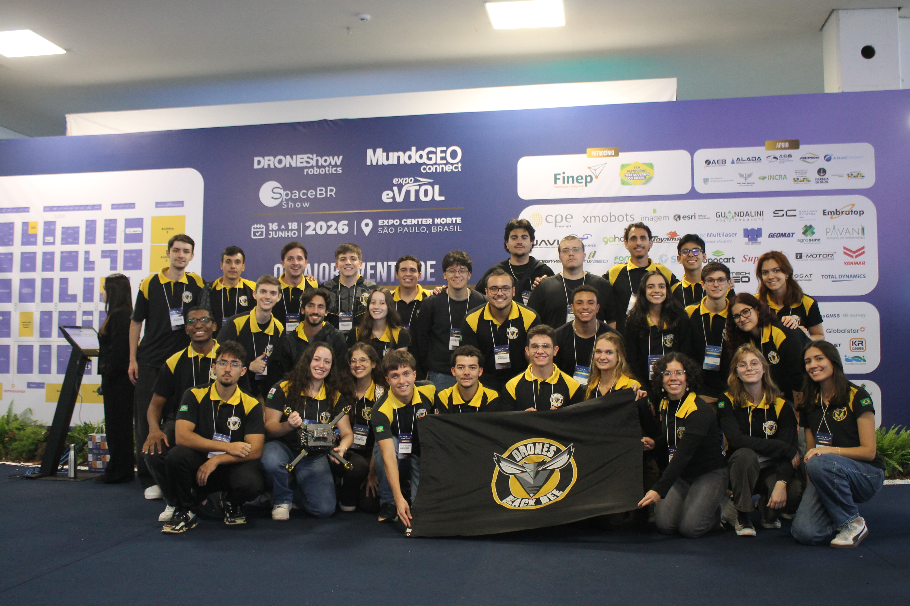
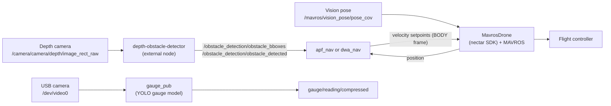

# dshw

**Autonomous obstacle avoidance and gauge reading for a MAVROS drone, built as a ROS 2 package and presented at Drone Show 2026.**



[▶ Watch the obstacle-avoidance demo](assets/demo_avoidance.mp4)

`dshw` is a small ROS 2 (`ament_python`) package that sits on top of the [nectar SDK](https://github.com/Black-Bee-Drones/nectar-sdk). It contains:

- **Two reactive navigation nodes** that fly the drone to a goal point while steering around obstacles seen by a depth camera: one based on **Artificial Potential Fields (APF)** and one on the **Dynamic Window Approach (DWA)**.
- **A gauge-reading node** that runs a YOLO model (`best.pt`) on a live camera feed and publishes the annotated result as a compressed image.
- **A mock publisher** to check topic plumbing without any hardware.

The gauge model was developed by **Black Bee Drones** for the [SAE Brasil AeroDesign 2026 faulty-gauge task](https://github.com/Black-Bee-Drones/SAE-2026/tree/master/faulty_or_not) and is available on [Hugging Face](https://huggingface.co/blackbeedrones/manometer-sae26). The navigation nodes consume obstacle detections published by the external [depth-obstacle-detector](https://github.com/lipe-pedras/depth-obstacle-detector) project.

---

## Table of contents

1. [What's in the package](#whats-in-the-package)
2. [System overview](#system-overview)
3. [Models and external components](#models-and-external-components)
4. [Requirements](#requirements)
5. [Build](#build)
6. [Running](#running)
7. [Testing without hardware](#testing-without-hardware)
8. [Configuration](#configuration)
9. [How it works](#how-it-works)
10. [Repository layout](#repository-layout)
11. [Known issues](#known-issues)
12. [Authors and license](#authors-and-license)

---

## What's in the package

| Executable | Source | Purpose |
|---|---|---|
| `apf_nav` | `dshw/apf/apf_nav.py` | Fly to the goal using attractive + repulsive potential fields |
| `dwa_nav` | `dshw/dwa/dwa_nav.py` | Fly to the goal by scoring a grid of candidate velocities (DWA) |
| `gauge_pub` | `dshw/gauge/gauge_pub.py` | Detect/classify gauge readings with YOLO and publish the annotated frame |
| `mock_pub` | `dshw/apf/mock_pub.py` | Publish dummy pose and depth topics for smoke tests |

All four are registered as console scripts, so you launch them with `ros2 run dshw <executable>`.

---

## System overview



The navigation nodes **do not detect obstacles themselves**. They consume bounding boxes from the external [depth-obstacle-detector](https://github.com/lipe-pedras/depth-obstacle-detector), which must already be running (see [Requirements](#requirements)).

---

## Models and external components

### Gauge-reading model

The YOLO model used by `gauge_pub` was developed by **Black Bee Drones** for the faulty-gauge identification task in [SAE Brasil 2026](https://github.com/Black-Bee-Drones/SAE-2026/tree/master/faulty_or_not).

- **Model:** [blackbeedrones/manometer-sae26](https://huggingface.co/blackbeedrones/manometer-sae26)
- **Task implementation and training project:** [SAE-2026/faulty_or_not](https://github.com/Black-Bee-Drones/SAE-2026/tree/master/faulty_or_not)
- **Integration in this package:** `dshw/gauge/gauge_pub.py`

The model is loaded through `nectar.ai.detection.Detector` with the Ultralytics framework. The repository currently includes a copy of the model weights at `dshw/models/best.pt`.

### Obstacle detection

Obstacle perception is provided by the external [depth-obstacle-detector](https://github.com/lipe-pedras/depth-obstacle-detector) project. It processes depth-camera information and publishes obstacle bounding boxes for the APF and DWA navigation nodes. This detector is a separate project and is **not included** in this repository.

The expected ROS topics and message formats are documented below in [Topics the navigation nodes expect](#topics-the-navigation-nodes-expect).

---

## Requirements

### Hardware

| Component | Notes |
|---|---|
| Drone with a MAVLink flight controller | Controlled through MAVROS. Velocity setpoints are sent in the body frame. |
| Companion computer | Paths in the code assume an NVIDIA Jetson (`/home/jetson/...`). |
| Depth camera | The constants assume a 424×240 depth stream published at `/camera/camera/depth/image_rect_raw` (the default naming of the RealSense ROS driver). |
| Vision pose source | Visual odometry/SLAM feeding `/mavros/vision_pose/pose_cov`. The `real` mode is configured with `PoseSource.VISION`. |
| USB/V4L2 camera | Only for `gauge_pub`. Opened as device index `0` (`/dev/video0`). |

### Software

| Dependency | Used for |
|---|---|
| Ubuntu + ROS 2 <!-- TODO: confirm distro (the committed bytecode is cpython-312, i.e. Ubuntu 24.04 / ROS 2 Jazzy) --> | Runtime and build (`colcon`) |
| MAVROS (`mavros`, `mavros_extras`) and its GeographicLib datasets | Link to the flight controller |
| [nectar SDK](https://github.com/Black-Bee-Drones/nectar-sdk) | `nectar.control` (`MavrosDrone`, `DroneFactory`, `MoveReference`, `MavrosConfig`, `SITL_VISION_CONFIG`) and `nectar.ai.detection` (`Detector`) |
| [depth-obstacle-detector](https://github.com/lipe-pedras/depth-obstacle-detector) | Depth-based obstacle perception; publishes the obstacle topics consumed by the navigation nodes |
| Python: `numpy`, `opencv-python`, `ultralytics` (+ `torch`) | Navigation math, camera capture, YOLO inference |
| ROS message packages: `std_msgs`, `geometry_msgs`, `sensor_msgs` | Topic types |

`nectar` and `ultralytics` must be importable from the Python environment that ROS 2 uses. On a Jetson, install the NVIDIA-provided `torch` build for your JetPack version rather than the generic PyPI wheel.

### Topics the navigation nodes expect

| Topic | Type | Used by | Content |
|---|---|---|---|
| `/obstacle_detection/obstacle_bboxes` | `std_msgs/Float32MultiArray` | `apf_nav`, `dwa_nav` | Flat array of **5 floats per obstacle cluster**. Index 0 and 1 are the horizontal pixel extents of the box, index 4 is the obstacle depth in metres. Indices 2 and 3 are not read by this package. |
| `/obstacle_detection/obstacle_detected` | `std_msgs/Bool` | `apf_nav` only | When `false`, `apf_nav` ignores the bounding boxes. |

The `obstacle_detection` prefix comes from `OBSTACLE_NS` in `dshw/constants.py`. Configure the external detector to publish the expected topic names and message formats.

---

## Build

`gauge_pub` loads its model from a hardcoded path, so clone the repo to `~/ros2_ws/src/dshw`:

```bash
mkdir -p ~/ros2_ws/src && cd ~/ros2_ws/src
git clone https://github.com/Soullis/dshw.git

cd ~/ros2_ws
colcon build --packages-select dshw --symlink-install
source install/setup.bash
```

Use `--symlink-install`. Without it, the `dshw.dwa` subpackage is not installed and `dwa_nav` will fail to import (see [Known issues](#known-issues)). It also means edits to `constants.py` take effect without rebuilding.

---

## Running

> ⚠️ **Safety first.** These nodes command real velocities. Test with propellers off or in simulation first, keep an RC override and kill switch within reach, and fly in a protected area. The default `V_MAX` is a conservative 0.15 m/s.

### Preconditions

- MAVROS is connected to the flight controller and publishing.
- The vision pose is being fed to `/mavros/vision_pose/pose_cov` and the pose estimate is good.
- The depth camera and the [depth-obstacle-detector](https://github.com/lipe-pedras/depth-obstacle-detector) node are running and publishing the topics above.
- **The vehicle is already armed, airborne and in a mode that accepts velocity setpoints.** `apf_nav` and `dwa_nav` never arm or take off; the `TAKEOFF_*` constants in `constants.py` are currently unused.
- The drone is facing the `+X` direction of the local frame (see [How it works](#how-it-works)).

### Navigation

```bash
# Real hardware (default)
ros2 run dshw apf_nav --ros-args -p mode:=real
ros2 run dshw dwa_nav --ros-args -p mode:=real

# Simulation (uses nectar's SITL_VISION_CONFIG; needs a running SITL/Gazebo setup)
ros2 run dshw apf_nav --ros-args -p mode:=gz
```

| `mode` | Meaning |
|---|---|
| `real` | `MavrosDrone` configured with `PoseSource.VISION` |
| `gz` | `MavrosDrone` configured with `SITL_VISION_CONFIG` |
| `cam` | Intended as a camera-only test mode that never commands the drone. See [Known issues](#known-issues). |

The node stops (sends a zero-velocity command and cancels its timer) when it gets within `GOAL_TOL` of the goal, when a flight command fails, or after `TIMEOUT` seconds. It does not land the drone.

### Gauge reading

```bash
ros2 run dshw gauge_pub
```

Preview the output:

```bash
ros2 run rqt_image_view rqt_image_view   # then select gauge/reading/compressed
```

---

## Testing without hardware

`mock_pub` publishes a dummy `PoseStamped` on `/mavros/vision_pose/pose_cov` and a dummy `String` on `/camera/camera/depth/image_rect_raw` at 10 Hz. It only checks that topics and nodes connect; the "depth image" is not a real image.

```bash
ros2 run dshw mock_pub
```

You can also fake obstacles for `apf_nav` or `dwa_nav` from the command line:

```bash
# Tell apf_nav obstacles are present
ros2 topic pub -r 10 /obstacle_detection/obstacle_detected std_msgs/msg/Bool "{data: true}"

# One obstacle: x_min, x_max, (unused), (unused), depth in metres
ros2 topic pub -r 10 /obstacle_detection/obstacle_bboxes std_msgs/msg/Float32MultiArray \
  "{data: [200.0, 260.0, 80.0, 160.0, 1.0]}"
```

The package also ships the default ament lint tests: `colcon test --packages-select dshw && colcon test-result --verbose`.

---

## Configuration

Tunable values live in plain Python modules, not ROS parameters. Edit them and rebuild (or use `--symlink-install`).

### `dshw/constants.py`

| Constant | Value | Meaning |
|---|---|---|
| `GOAL_M` | `[5.0, 0.0, 0.0]` | Goal in the local frame: 5 m ahead along `+X` |
| `K_ATT` | `0.6` | APF attractive gain |
| `K_REP` | `1.2` | APF repulsive gain |
| `D0` | `1.5` m | APF influence distance; obstacles farther than this are ignored |
| `V_MAX` | `0.15` m/s | Speed cap on the commanded velocity |
| `GOAL_TOL` | `0.25` m | Distance at which the goal counts as reached |
| `TIMEOUT` | `360` s | Maximum run time before the node aborts |
| `LOOP_HZ` | `20` Hz | Control-loop rate (also used by `gauge_pub`) |
| `OBSTACLE_NS` | `"obstacle_detection"` | Namespace of the obstacle topics |
| `WIDTH`, `HEIGHT` | `424`, `240` | Depth image size used to normalise pixel offsets |
| `DEVICE` | `0` | V4L2 camera index for `gauge_pub` |
| `TAKEOFF_ALT`, `TAKEOFF_MAX_TRIES` | `1.5`, `5` | Defined but currently unused |

### `dshw/dwa/dwa_math.py`

| Constant | Value | Meaning |
|---|---|---|
| `HEADING_WEIGHT` | `2.0` | Weight of the goal-progress score |
| `CLEARANCE_WEIGHT` | `1.0` | Weight of the obstacle-clearance score |
| `VELOCITY_WEIGHT` | `0.2` | Weight of the speed score |
| `SIM_TIME` | `1.5` s | Look-ahead horizon for each candidate velocity |
| `V_RESOLUTION` | `11` | Velocity samples per axis (an 11×11 grid) |
| `COLLISION_RADIUS` | `0.5` m | Candidates ending closer than this to an obstacle are rejected |

### `gauge_pub`

The confidence threshold (`0.5`) and the model path are set inside `GaugeReading.__init__`. Crops overlap by 30% (`_get_square_crops`).

---

## How it works

### Shared control loop

Both navigation nodes run a 20 Hz timer. Each tick they:

1. Read the drone position from `MavrosDrone` as a `PoseStamped`, and skip the tick if none is available yet.
2. Stop if the timeout expired or the goal is within `GOAL_TOL`.
3. Compute a velocity command `(vx, vy)`, clipped to `V_MAX`.
4. Send it with `move_velocity(vx, vy, 0, 0, reference=MoveReference.BODY)`: altitude is held (`vz = 0`) and yaw rate is zero.

The goal vector is computed in the local frame but velocities are sent in the body frame, so the logic assumes the drone is facing `+X` of the local frame (towards the goal) and keeps that heading.

### APF (`apf_nav`)

```text
F_att = K_ATT * (GOAL - pos)

for each obstacle cluster with 0 < depth < D0:
    mag = K_REP * (1/depth - 1/D0) * (1/depth)^2
    dir = normalize([-1, cx_norm, 0])        # push back and away sideways
    F_rep += mag * dir

v = F_att + F_rep, clipped to V_MAX
```

`cx_norm` is the horizontal centre of the bounding box, normalised to `[-1, 1]` using the image width (`WIDTH = 424`). Bounding boxes are only used while `/obstacle_detection/obstacle_detected` is `true`.

### DWA (`dwa_nav`)

For every `(vx, vy)` in an 11×11 grid between `-V_MAX` and `+V_MAX`:

1. Project the drone `SIM_TIME` seconds ahead at that constant velocity.
2. Reject the candidate if that end point is within `COLLISION_RADIUS` of any obstacle.
3. Score the rest: `HEADING_WEIGHT / (dist_to_goal + 0.1)` + `CLEARANCE_WEIGHT * min_obstacle_dist` + `VELOCITY_WEIGHT * speed`.
4. Command the highest-scoring velocity.

Obstacles are turned into 2D points in the body frame from their depth and horizontal image offset, using an approximate 60° horizontal field of view. Only each candidate's end point is checked, not the whole path.

### Gauge reading (`gauge_pub`)

1. Grab a frame from the V4L2 camera at `LOOP_HZ`.
2. Cut it into overlapping square crops (side = the shorter image dimension, 30% overlap) so a wide frame is not squashed.
3. Run the YOLO model (`dshw/models/best.pt`) on every crop and keep the most confident detection above `0.5`.
4. Draw `<confidence>% <class_id>` on the annotated crop, publish it as JPEG on `gauge/reading/compressed`, and save it to `~/ros2_ws/src/saved_images/dshw/<timestamp>.jpg`.

The model was trained for the SAE Brasil 2026 faulty-gauge task. See [the model on Hugging Face](https://huggingface.co/blackbeedrones/manometer-sae26) and its [training/task implementation](https://github.com/Black-Bee-Drones/SAE-2026/tree/master/faulty_or_not).

---

## Repository layout

```text
dshw/
├── assets/
│   ├── demo_avoidance.mp4  # obstacle-avoidance demo
│   ├── team.JPG            # team/event photo used above
│   └── hero.CR2            # original RAW photo
├── dshw/
│   ├── constants.py        # shared navigation / camera constants
│   ├── apf/
│   │   ├── apf_nav.py      # APF navigation node
│   │   ├── apf_math.py     # attractive / repulsive force functions
│   │   └── mock_pub.py     # dummy pose + depth publisher
│   ├── dwa/
│   │   ├── dwa_nav.py      # DWA navigation node
│   │   └── dwa_math.py     # DWA scoring and parameters
│   ├── gauge/
│   │   └── gauge_pub.py    # YOLO gauge-reading node
│   └── models/
│       └── best.pt         # YOLO weights (~12.5 MB)
├── resource/dshw           # ament index marker
├── test/                   # default ament lint tests
├── package.xml
├── setup.py
└── setup.cfg
```

---

## Known issues

These are the rough edges of the code as presented. None of them are hidden by the demo, but you will hit them if you run the repo from scratch.

- **`gauge_pub` imports a package that is not in this repo.** `from faulty_or_not.parameters import DEVICE` fails with `ModuleNotFoundError` unless that package is installed. The value is immediately overridden by the `dshw.constants` import below it, so the line can be removed.
- **Hardcoded model path.** `gauge_pub` loads `/home/jetson/ros2_ws/src/dshw/dshw/models/best.pt`. Clone to `~/ros2_ws/src/dshw` as a user named `jetson`, or edit the path.
- **`gauge_pub` shutdown.** `cleanup()` reads `self._is_shutdown` before it is ever set and calls `self.image_handler`, which does not exist, so Ctrl+C ends with an `AttributeError`.
- **`gauge_pub` with no detection.** When nothing is detected, `frame` has already been reassigned to the list of crops, which is then passed to the JPEG encoder instead of an image.
- **Unbounded image saving.** Every detection writes a JPEG to `~/ros2_ws/src/saved_images/dshw/`, so long runs fill the disk.
- **`cam` mode is incomplete.** In `cam` mode no drone object is created, but the control loop still reads `self.drone.position`, which raises `AttributeError`.
- **`dshw.dwa` is not installed by a normal build.** `dshw/dwa/` has no `__init__.py`, so `find_packages()` skips it. Add the file, or build with `--symlink-install`.
- **DWA image width is hardcoded.** `dwa_math.py` normalises with `160.0`, while the rest of the package uses `WIDTH = 424`.
- **DWA ignores `obstacle_detected`** and keeps using the last bounding boxes it received.
- **Package metadata is a placeholder.** `package.xml` and `setup.py` still say `TODO` for description and license, and `package.xml` declares no runtime dependencies, so `rosdep install` will not pull any in.

---

## Authors and license

Developed by **Gabriel Solis** ([@Soullis](https://github.com/Soullis)).

**Gauge model:** developed by Black Bee Drones for the [SAE Brasil 2026 faulty-gauge task](https://github.com/Black-Bee-Drones/SAE-2026/tree/master/faulty_or_not).

**Obstacle perception:** powered by [depth-obstacle-detector](https://github.com/lipe-pedras/depth-obstacle-detector).

**License:** not yet declared. <!-- TODO: choose a license, add a LICENSE file, and update package.xml and setup.py. -->
